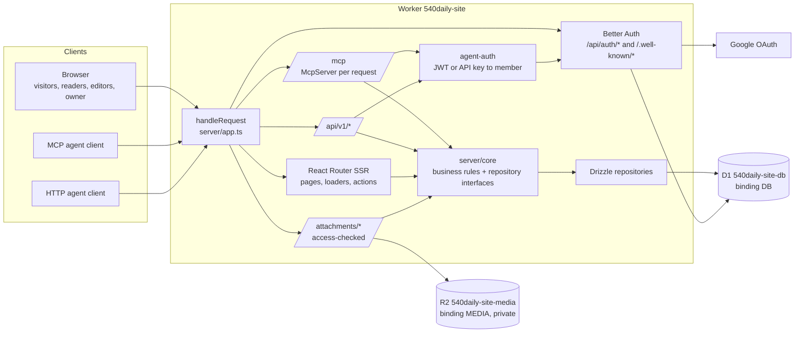

# Architecture

How 540 Daily is put together. Product behavior is defined in [REQUIREMENTS.md](REQUIREMENTS.md); this document covers structure. The patterns come from an earlier production app built the same way and are adapted here to 540 Daily.

## 1. One Worker, one origin

There is **one deployable unit**: a Cloudflare Worker named `540daily-site`, serving every path on `https://540daily.com`. Pages, Better Auth (OAuth for MCP clients plus Google sign-in), the MCP endpoint, the HTTP API, and attachment routes all share that origin. This is required: the OAuth issuer, the MCP resource URL, and the Google redirect URI are all derived from `PUBLIC_BASE_URL`.



## 2. Layers

| Layer | Folder | Responsibility | May import |
| --- | --- | --- | --- |
| Host entry | `hosting/cloudflare/worker.ts` (and `hosting/node/` for browser tests) | Read env and bindings, build `Services`, call `handleRequest` | Everything |
| Request router | `server/app.ts` | `createServices()` wiring and `handleRequest()` path dispatch | Adapters, core, auth, mcp |
| Protocol layers | `server/mcp/`, `server/api-v1.ts`, `server/media-routes.ts`, `app/routes/*` | Translate MCP, HTTP, and form posts into core calls | Core, adapters, auth |
| Core (business rules) | `server/core/` | Pure logic and repository/storage **interfaces** | zod and other core files only (lint-enforced) |
| Adapters | `server/adapters/` | Implement core interfaces with Drizzle and R2 | Drivers, SDKs |
| Auth | `server/auth/`, `server/agent-auth.ts` | Better Auth instance; agent credential checks | Better Auth |
| Schema | `server/db/`, `db/migrations/` | Drizzle tables; generated SQL migrations | drizzle-orm |
| UI | `app/` | Routes, components, client helpers | Server code only from loaders, actions, and `*.server.ts` |

**MCP tools, HTTP API handlers, and editor form actions are thin.** They parse input, call the **same core publication service**, and format output. Validation, ownership, idempotency, revisions, and visibility rules live only in core.

## 3. Request routing

`server/app.ts` `handleRequest` checks paths in this order:

1. `/health` → `{ ok, host, checks: { database, media } }`; 503 if a check fails. No secrets or config values.
2. `/api/auth`, `/api/auth/*`, and `/.well-known/*` → Better Auth.
3. `/mcp` (exact) → `handleMcp()`.
4. `/api/v1` and `/api/v1/*` → `handleApiV1()`.
5. `GET|HEAD /attachments/*` → attachment serving with a visibility check (see [DATA_AND_STORAGE.md](DATA_AND_STORAGE.md) section 7).
6. Everything else → React Router (`createRequestHandler`): pages, `/sitemap.xml`, and any UI JSON routes declared in `app/routes.ts`.

After dispatch, each response is copied into a new `Response` so headers can be set (responses from `fetch()` can have immutable headers). Use this to set `X-Robots-Tag: noindex` on **private** paths only: `/sign-in`, `/consent`, `/dashboard`, `/saved`, `/editor*`, `/owner*`, `/api/*`, `/mcp`. Public pages stay indexable. Do not add a site-wide `noindex`.

## 4. Services are built per request

`createServices(deps)` builds one `Services` object: config, `db`, `auth`, `media`, and every core service. Loaders and actions read it with `context.get(servicesContext)`.

- **On Workers, build `Services` (including the Better Auth instance) on every request.** In the earlier app, reusing a Better Auth instance across requests let lazy initialization leak between requests, and sign-in hung intermittently. Only parsed config (plain data) is cached per isolate, in a `WeakMap<Env, AppConfig>`. Cost: about 1–2 ms of CPU.
- The Node test host may build services once.

## 5. State

- **Durable state:** D1 for all data, R2 for attachment bytes. No KV, Durable Objects, queues, or cache layer.
- **Sessions:** Better Auth session cookie (`better-auth.session_token`, signed), with session rows in D1.
- **MCP:** stateless. Each POST gets a fresh `McpServer`; no MCP session IDs are stored.
- **Rate limits:** counters in a D1 table so limits hold across Worker instances (see [MCP_AND_AUTH.md](MCP_AND_AUTH.md) section 8).
- **Client state:** React state and loader data. `localStorage` only for an anonymous visitor's theme, wrapped in try/catch.

## 6. Who can call what

| Caller | Credential | Checked by | Result |
| --- | --- | --- | --- |
| Visitor | None | — | Public reads only |
| Member (reader, editor, owner) | Better Auth session cookie from Google sign-in | `getViewer()` | `Viewer { userId, email, name, role, status }`, re-read from D1 on every request |
| Agent over MCP or HTTP, acting as a member | `Authorization: Bearer` with an OAuth JWT or the member's API key | `authenticateAgent()` | `AgentPrincipal { userId, role, credentialKind, credentialId, label }`, role re-read from D1 on every call |

Agents act as the member who connected them, limited to creating publications and updating the member's own. Agent credentials never count as a browser session, and a session cookie never authorizes `/mcp` or `/api/v1`. Details: [MCP_AND_AUTH.md](MCP_AND_AUTH.md).

## 7. Background work

**None at launch.** No cron triggers, queues, `waitUntil` jobs, or Durable Objects. Everything happens inside the request. The owner-run cleanup of old unreferenced uploads is an explicit action.

## 8. Outbound requests

- Google OAuth, through Better Auth.
- MCP client metadata documents (CIMD), fetched by Better Auth through a Workers-safe fetcher: HTTPS only, GET/HEAD only, publicly routable hosts only, redirects refused.
- Nothing else. Source links in publications are **never** fetched.

## 9. Project structure

```
540daily-site/
  AGENTS.md, CLAUDE.md, README.md
  package.json                  exact pins, engines, allowScripts
  tsconfig.json
  vite.config.ts                BUILD_TARGET=cloudflare (default) | node
  react-router.config.ts        { ssr: true }
  drizzle.config.ts             dialect sqlite, schema server/db/schema.ts, out db/migrations
  eslint.config.js              typescript-eslint + core-isolation rule
  vitest.config.ts              tests/**/*.test.ts
  playwright.config.ts          Node build of the app

  app/
    root.tsx                    layout, root loader (viewer, theme), ErrorBoundary
    routes.ts                   explicit route table
    entry.server.tsx            renderToReadableStream
    context.ts                  servicesContext + createRouterContext(services)
    session.server.ts           getViewer(request, services)
    access.server.ts            requireMember / requireEditor / requireOwner (page and write variants)
    auth-client.ts              Better Auth browser client
    routes/                     home, categories, category, publication, search, dashboard, saved,
                                sign-in, consent, account, editor/*, owner/*, sitemap.xml
    components/
    styles/app.css              hand-written CSS with light/dark design tokens

  server/
    app.ts                      Services, createServices(), handleRequest()
    config.ts                   zod env schema → AppConfig
    core/                       NO framework, host, DB driver, or SDK imports
      access.ts                 roles, membership rules, invitation matching
      publications.ts           schema, validation, create/update/replay, revisions, visibility
      categories.ts             normalization, slugs, homepage layout
      tags.ts
      attachments.ts            type/size/signature rules, ownership, upload tickets
      markdown.ts               interface for the safe renderer (implementation in adapters)
      search.ts
      preferences.ts            personal layout, interest filters, theme
      bookmarks.ts
      api-keys.ts               member API key rules
      rate-limits.ts
      audit.ts
    adapters/
      db.ts                     Database type (D1 or better-sqlite3)
      atomic.ts                 atomic(): D1 batch or SQLite transaction
      *-repo.ts                 Drizzle repositories implementing core interfaces
      media.ts                  MediaStore interface
      markdown.ts               Markdown → sanitized HTML
    auth/
      auth.ts                   createAuth(): Better Auth + jwt + mcp + cimd + invitation gate
      cimd-fetch.ts             Workers-safe CIMD fetch
    mcp/
      server.ts                 McpServer factory and tool registrations
      endpoint.ts               handleMcp(): agent auth, 401 challenge, dispatch
    agent-auth.ts               authenticateAgent(): JWT or API key → AgentPrincipal (the member)
    api-keys.ts                 member API key create/verify/revoke (hashed)
    api-v1.ts                   HTTP API over the same core calls
    media-routes.ts             /attachments/* serving and upload endpoint
    integration.ts              one JSON shape for MCP and HTTP results
    db/
      schema.ts                 export * from auth-schema and app-schema
      auth-schema.ts            GENERATED by `npm run auth:schema`
      app-schema.ts             540 Daily tables

  db/migrations/                generated SQL + custom SQL (FTS5); commit meta/ too

  hosting/
    cloudflare/
      worker.ts                 the only file that reads bindings
      wrangler.jsonc
      worker-configuration.d.ts GENERATED by `wrangler types`; committed
      .dev.vars.example         placeholders only
      r2-media.ts               MediaStore over R2
    node/                       test host for Playwright
      app.ts, server.js, fs-media.ts

  scripts/
    auth-cli-config.ts          dummy config so the Better Auth CLI can build the schema

  tests/
    helpers/                    createTestServices(), request(), sessionCookieFor(), connectAgent()
    core/                       pure logic tests
    server/                     route, MCP, HTTP API, auth tests (in-memory SQLite)
    e2e/                        Playwright specs
```

This tree is the target layout. Adjust file names as the code takes shape, and keep [AGENTS.md](../../AGENTS.md) current.

### Folder rules

- **`server/core/`** must not import `cloudflare:*`, `@cloudflare/*`, `wrangler`, `react`, `react-dom`, `react-router`, `@react-router/*`, `better-sqlite3`, `drizzle-orm`, `better-auth`, `@better-auth/*`, `@modelcontextprotocol/*`, `node:*`, or anything under `adapters/` or `hosting/`. ESLint enforces this (rule in [IMPLEMENTATION_PATTERNS.md](IMPLEMENTATION_PATTERNS.md) section 10). zod is allowed.
- **`hosting/*`** is the only code that reads environment variables or bindings.
- **`server/mcp/`** and **`server/api-v1.ts`** are thin.
- **`app/`** reaches server code only from loaders, actions, and `*.server.ts` files.

### Naming

- Files: kebab-case (`publications-repo.ts`, `agent-auth.ts`).
- Route modules registered explicitly in `app/routes.ts`; server-only UI helpers end in `.server.ts`.
- Factories: `createX()` returning an object of async functions. No classes except small adapters (`R2MediaStore`).
- Data ports: `XRepository` interfaces in core.
- DB columns: snake_case in SQL, camelCase in Drizzle. Timestamps: `integer(..., { mode: "timestamp_ms" })`, stored in UTC.
- Tests: `*.test.ts` (Vitest), `*.spec.ts` (Playwright). Cite acceptance IDs (A1–A17) in test names.

### Where new code goes

| You are adding | Put it in |
| --- | --- |
| A business rule or validation | `server/core/<feature>.ts` |
| A table | `server/db/app-schema.ts`, then `npm run db:generate` |
| Data access | `server/adapters/<feature>-repo.ts`, implementing a core interface |
| A page | `app/routes/<name>.tsx` plus an entry in `app/routes.ts` |
| An MCP tool | `server/mcp/server.ts`, calling a core function |
| The same operation over HTTP | `server/api-v1.ts`, calling the same core function |
| A service on `Services` | `server/app.ts` |
| An env var | `server/config.ts`, `.dev.vars.example`, and `wrangler.jsonc` vars or a secret |
