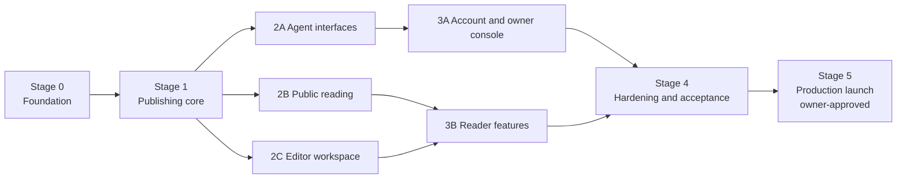

# Build plan: stages and parallel lanes

This plan breaks the launch scope in [REQUIREMENTS.md](REQUIREMENTS.md) into stages. Each stage ends with working, tested code merged to `main`. Some stages split into **lanes** that can run at the same time in separate git worktrees.

The full launch scope is still the goal. Stages only control the order and the merge points.

## 1. Overview



| Stage | Mode | Main acceptance checks |
| --- | --- | --- |
| 0 Foundation | One session | A15 (partial), A2 (sign-in gate) |
| 1 Publishing core | One session | A5, A7, A10, A11 (core level) |
| 2 Interfaces | Three parallel lanes | A1, A4, A5, A6, A8, A10, A13, A14 |
| 3 Members | Two parallel lanes | A2, A3, A9 |
| 4 Hardening | One session, with review subagents | A11, A12, A15, all A1–A15 rerun |
| 5 Launch | Owner-driven | A17 |

Stages 0 and 1 are serial on purpose. They create the schema and the shared core that every later lane depends on. Running them in parallel would cause merge conflicts and duplicate logic.

## 2. Rules for parallel work

These rules keep parallel lanes from colliding.

1. **One worktree and one branch per lane**, named `feature/stage-<n><lane>-<topic>` (for example `feature/stage-2a-agent-interfaces`). Each lane starts from `main` after the previous stage has merged.
2. **Schema and migrations have one owner per stage.** Stage 0 creates all tables the plan knows about, so most lanes need no migrations at all. If a lane truly needs a schema change, it adds **one** new migration file, and lanes merge one at a time. After each merge, the next lane rebases and runs `npm run db:generate` again if needed. Never hand-merge two generated migrations or their `meta/` snapshots.
3. **Shared files are pre-wired.** Stage 0 creates `app/routes.ts` entries, `Services` fields in `server/app.ts`, and empty route files for every planned page. Lanes then fill in their own files and avoid editing shared ones. If a lane must touch a shared file, keep the change small and expect a rebase.
4. **Each lane owns its folders** (listed per lane below). A lane does not edit another lane's files. Fixes needed in core go through the lane that owns core in that stage, or are noted for the next serial stage.
5. **Merge gate:** `npm run check` passes on the lane branch, rebased on the current `main`. Merge, then the next lane rebases.
6. **Every lane updates AGENTS.md** only in its own section, if it adds commands or rules.

## 3. Stages

### Stage 0 — Foundation (one session)

**Goal:** an empty but real app that builds, runs, tests, and signs members in.

Scope:

- Choose current, compatible package versions per the version policy in [STACK.md](STACK.md); pin them and fill in its "Chosen versions" table. Choose the Markdown parser and sanitizer.
- Scaffold: `package.json`, TypeScript, Vite, React Router, Wrangler config with placeholder IDs, `.dev.vars.example`, ESLint with the core-isolation rule, Vitest, Playwright, and the Node test host.
- `server/config.ts`, `hosting/cloudflare/worker.ts`, `server/app.ts` with `handleRequest` dispatch and `/health`.
- **Full schema:** auth tables plus every entity in [REQUIREMENTS.md](REQUIREMENTS.md) section 7, the FTS5 table and triggers, and the one-time category seed. Generate migrations.
- Better Auth with Google, the membership gate (`OWNER_EMAIL`, invitations, active members), `getViewer`, and the role checks with the same-origin check.
- App shell: root layout, light/dark theme tokens, error boundary, and stub routes for every page in requirements section 5, all registered in `app/routes.ts`.
- `Services` interface with a field for every planned service (stubs are fine).
- Test helpers: `createTestServices`, `request`, `sessionCookieFor` with roles, `MemoryMediaStore`.
- CI workflow running `npm run check` on pull requests.

Exit: `npm run check` passes; `npm run dev` shows the shell; tests prove an uninvited email cannot register and the owner email can (A2, partial); migrations apply to a fresh local database (A15, partial).

### Stage 1 — Publishing core (one session)

**Goal:** all the publishing rules, tested without any UI or protocol.

Scope (mostly `server/core/` and `server/adapters/`):

- Publication validation schema shared by all interfaces.
- Category and tag normalization, slugs, homepage layout model.
- Create with receipts, replay, and conflict; update with an expected revision; revision snapshots; restore as a new revision; unpublish and restore visibility; the agent ownership rule.
- Search repository over FTS5 with filters, ordering, and Chicago date handling.
- Attachment rules: type, size, signature, alt text, ownership, upload tickets, and the visibility check for serving. `MediaStore` with R2 and filesystem adapters.
- Safe Markdown renderer with `attachment:ID` rewriting.
- Bounded publishing-failure log and audit events.

Exit: core and repository tests cover duplicate and concurrent creates (A5), revision conflicts and history (A7), search matching and filters (A10), and Markdown injection cases and attachment rejection (A11).

### Stage 2 — Interfaces (three parallel lanes)

All three lanes start from `main` after Stage 1 merges. They call the Stage 1 core and do not change its rules.

**2A — Agent interfaces**

- Owns: `server/mcp/`, `server/api-v1.ts`, `server/agent-auth.ts`, `server/api-keys.ts`, `server/integration.ts`, the upload endpoints in `server/media-routes.ts`, `app/routes/consent.tsx`, and their tests.
- Agents acting as members: API key verification, the consent page for any member, role and revocation checks on every call, and the create/update-own guardrails.
- The six MCP tools and matching HTTP endpoints, the upload ticket flow, rate limits, and operational logging.
- Exit: A4 (both interfaces create and read back), A5 across MCP and HTTP, A6, A13.
- Note: the `/account` and `/owner` screens for keys and connections come in 3A. Here, tests create keys through core.

**2B — Public reading**

- Owns: `app/routes/` for home, categories, category, publication detail, search, sitemap; public components; the `GET /attachments/*` route; robots headers.
- Dashboard panels, drill-down pages, related items, search page with filters and the date-basis note, pagination, empty and error states.
- Exit: A1 (anonymous reads; protected writes fail), A8 public side (unpublished items vanish everywhere, attachments blocked), A10 through the UI.

**2C — Editor workspace**

- Owns: `app/routes/editor*`, editor components, editor attachment upload.
- Publication list, create and edit with Markdown preview, drafts and publish, history and restore, unpublish and restore, homepage category selection and order (with move-up/down buttons).
- Exit: A7 in the UI, A8 editor side, A14 end to end.

### Stage 3 — Members (two parallel lanes)

Each lane can start once the lanes it depends on have merged (see the overview diagram).

**3A — Account and owner console** (after 2A)

- Owns: `app/routes/account.tsx`, `app/routes/owner*`, and their components.
- `/account`: a member's own MCP connections (disconnect) and, for editors and the owner, API keys (create, revoke).
- Invitations with a copyable sign-in link, role changes, account disable, sole-owner protection, all members' MCP connections and API keys (revoke), recent publishing failures, and the explicit cleanup of unreferenced uploads older than seven days.
- Exit: A2 complete; A3 (editors cannot manage access or other members' keys); A6 through the UI.

**3B — Reader features** (after 2B and 2C)

- Owns: `app/routes/dashboard.tsx`, `app/routes/saved.tsx`, preference and bookmark components.
- Personal dashboard seeded from the public layout, panel choice and order, interest-tag filters, bookmarks with the unavailable placeholder, theme saved to the account.
- Exit: A9; A3 (reader A cannot see or change reader B's data).

### Stage 4 — Hardening and acceptance (one session, with review subagents)

- Playwright journeys for phone, tablet, and desktop in both themes; keyboard navigation and panel reordering; axe checks (A12).
- Write the deliverable docs: API and MCP contract with examples, owner/editor operating guide, deployment checklist.
- Rerun A1–A15 and write the completion report, separating local, faked, and live checks.

### Stage 5 — Production launch (owner-driven)

Provisioning, secrets, the Google OAuth client, the first remote migration and deploy, Workers Builds, and the live checks in A17. Each step needs the owner's explicit approval, following [DEVELOPMENT_AND_DEPLOYMENT.md](DEVELOPMENT_AND_DEPLOYMENT.md) sections 6–9.

## 4. Using sessions and subagents

| Tool | Use it for |
| --- | --- |
| **One Claude Code session per stage or lane**, each in its own worktree | The building work. A stage or lane is a self-contained task with its own branch and merge. Start parallel lanes at the same time once their dependencies have merged |
| **Subagents inside a session** | Work whose result the session needs right away: searching docs, writing a batch of tests from the acceptance table, or reviewing a finished lane against REQUIREMENTS.md before merge |
| **`/code-review`** before each merge | A bug-focused review of the lane's diff |

Do not split one lane across several sessions. Lanes are already sized so one session can hold the whole context.

### Starting prompt for a stage or lane session

```text
Build <stage/lane name> of 540 Daily, as defined in docs/540daily/BUILD_PLAN.md.
Read AGENTS.md, BUILD_PROMPT.md, REQUIREMENTS.md, and the technical docs it lists.
Work on branch feature/stage-<id>-<topic> from current main.
Stay inside the folders this lane owns; note anything outside them instead of changing it.
Done means: the lane's exit checks pass as automated tests, `npm run check` passes,
and you report what ran, what was faked, and what was not run. Do not merge or push.
```

## 5. Merge order

1. Stage 0 → `main`.
2. Stage 1 → `main`.
3. 2A, 2B, 2C in any order; each rebases on `main` before merging.
4. 3A (after 2A), 3B (after 2B and 2C).
5. Stage 4 → `main`.
6. Stage 5 runs from `main` with the owner.

Run `npm run check` on `main` after every merge. If it fails, fix it before starting the next lane.
