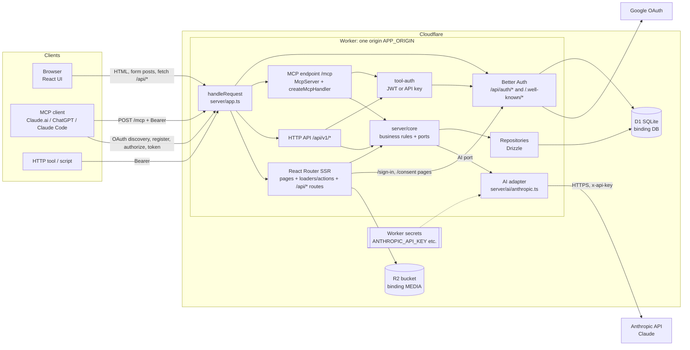

# Architecture

## Boundaries at a glance

There is **one deployable unit**: a Cloudflare Worker. It serves every path on one origin (`<APP_ORIGIN>`). Inside it, code is layered:

| Layer | Folder | Responsibility | May import |
| --- | --- | --- | --- |
| Host entry | `hosting/cloudflare/worker.ts` (and optional `hosting/node/`) | Read env and bindings, build `Services`, call `handleRequest` | Everything |
| Request router | `server/app.ts` | `createServices()` wiring + `handleRequest()` path dispatch | Adapters, core, auth, mcp |
| Protocol layers | `server/mcp/`, `server/api-v1.ts`, `app/routes/*` | Translate MCP / HTTP / form posts into core calls | Core, adapters, auth |
| Core (business rules) | `server/core/` | Pure logic + repository and AI **interfaces** ("ports") | zod and other core files only (lint-enforced) |
| Adapters | `server/adapters/`, `server/ai/`, `server/importers/` | Implement ports with Drizzle, Anthropic SDK, `fetch` | SDKs, drivers |
| Auth | `server/auth/`, `server/tool-auth.ts` | Better Auth instance; bearer-token checks for tools | Better Auth |
| Schema | `server/db/` + `db/migrations/` | Drizzle tables; generated SQL migrations | drizzle-orm |
| UI | `app/` | React Router routes, components, client helpers | `server/*` only from `*.server.ts` and loaders/actions |

## Diagram

Note: in the source app no MCP tool calls Claude. MCP and Claude are separate paths that share the core layer and the database.

## Request routing (confirmed, `server/app.ts` `handleRequest`)

Checked in this order:

1. `/health` → JSON `{ ok, host, checks: { database, media } }`; 503 if a check fails.
2. `/api/auth` or `/api/auth/*`, and `/.well-known/*` → `services.auth.handler(request)` (Better Auth).
3. `/mcp` (exact) → `handleMcp()`.
4. `/api/v1` or `/api/v1/*` → `handleApiV1()`.
5. `GET|HEAD /media/*` → file serving from the media store (with an admin check for unpublished files).
6. Everything else → React Router (`createRequestHandler`), including page routes and UI JSON routes under `/api/*` that are declared in `app/routes.ts`.

After dispatch, every response is copied into a new `Response` so a header can be set (`X-Robots-Tag: noindex, nofollow` in the source app; site-specific). Copying is needed because responses from `fetch()` can have immutable headers.

## Services and the per-request rule

`createServices(deps)` builds one `Services` object containing config, `db`, `auth`, `media`, every core service, and the AI adapter. Route loaders/actions read it with `context.get(servicesContext)`.

- **Workers: build services per request.** The source app's comment in `worker.ts`: reusing a Better Auth instance across requests let lazy initialization leak between requests and sign-in intermittently hung. Only the parsed config (plain data) is cached per isolate in a `WeakMap<Env, AppConfig>`. Measured cost noted in the source: about 1–2 ms CPU.
- **Node: build once.** A long-lived process may reuse services.

## State

- **Server state**: all durable state in D1 (and files in R2). No KV, Durable Objects, queues, or cache layer.
- **Sessions**: Better Auth session cookie (`better-auth.session_token`, signed), session rows in D1.
- **MCP**: stateless. No MCP session IDs are stored; each POST is served by a fresh `McpServer`.
- **Client state**: React state and React Router loader data. `localStorage` only for small per-device preferences, wrapped in try/catch.

## Authentication model (confirmed)

| Caller | Credential | Checked by | Result |
| --- | --- | --- | --- |
| Browser user | Better Auth session cookie from Google sign-in | `getViewer()` → `auth.api.getSession()` | Viewer `{ userId, email, name, image, isAdmin }` |
| Admin gate | Session + email allow-list (`ADMIN_EMAILS`) | `requireAdminPage` (redirect / 403) and `requireAdminWrite` (401 / 403) | Re-checked on every request |
| Sign-in gate | Google email | Better Auth `user.validateUserInfo` hook | Non-admins can never create a user |
| MCP / HTTP API tool | `Authorization: Bearer <JWT access token>` from the OAuth flow, or a personal API key | `authenticateTool()` | `Submitter { credentialKind, credentialId, clientName, userId }`, acting for an admin |

Tool credentials never count as a browser session, and the admin allow-list is re-checked on every tool call.

## Background tasks

**None.** No cron triggers, queues, `waitUntil` jobs, or Durable Objects (confirmed: none in `wrangler.jsonc` or code). Long work (Claude calls up to 240 s) happens inside the request. Heavy CPU work (image resize, zip build) is pushed to the browser because of the Workers free-plan CPU limit (~10 ms per request; waiting on network/DB does not count).

## External services

- Anthropic API (from `server/ai/anthropic.ts` only).
- Google OAuth (via Better Auth).
- Arbitrary web pages fetched through an SSRF-guarded fetcher (`server/importers/fetch-page.ts`): http(s) only, standard ports, no private/local hosts, every redirect re-checked (max 5), 3 MB cap, timeout.
- MCP client metadata documents (CIMD) fetched by Better Auth through a host-specific fetcher (`server/auth/cimd-fetch.ts` on Workers: HTTPS only, GET/HEAD only, publicly routable hosts only, redirects refused).

## Trace 1: an MCP client creates a record (MCP path, no Claude)

This flow exists in the source app (its create tool). Generic names used here.

1. **Connect (once).** The user adds `<APP_ORIGIN>/mcp` as a custom connector in Claude.ai.
2. Client `POST /mcp` without a token → `handleMcp` → `authenticateTool` returns `missing` → **401** with JSON-RPC error `-32001` and `WWW-Authenticate: Bearer resource_metadata="<APP_ORIGIN>/.well-known/oauth-protected-resource/mcp"`.
3. Client `GET /.well-known/oauth-protected-resource/mcp` → Better Auth → `{ resource: "<APP_ORIGIN>/mcp", authorization_servers: ["<APP_ORIGIN>/api/auth"] }`.
4. Client `GET /.well-known/oauth-authorization-server/api/auth` → metadata with `registration_endpoint`, `code_challenge_methods_supported: ["S256"]`, `client_id_metadata_document_supported: true`.
5. Client identifies itself with a CIMD URL or registers at `/api/auth/oauth2/register`, then opens `/api/auth/oauth2/authorize?...&resource=<APP_ORIGIN>/mcp` (PKCE S256).
6. No session → Better Auth redirects to the app page `/sign-in` (React Router). User signs in with Google; the sign-in gate rejects non-admin emails.
7. Better Auth redirects to `/consent?<signed query>`. The consent loader verifies the signed query with `verifyOAuthQueryParams`, requires an admin viewer, and shows the client's name and domain. The user presses **Allow** → `authClient.oauth2.consent({ accept: true })` → redirect to the client with a code.
8. Client exchanges the code at `/api/auth/oauth2/token` → JWT access token (audience `<APP_ORIGIN>/mcp`) + refresh token.
9. **Call.** Client `POST /mcp` with `Authorization: Bearer <jwt>`, JSON-RPC `tools/call { name: "submit_item", arguments: {...} }`.
10. `authenticateTool` verifies the JWT in-process (`verifyJwsAccessToken`, JWKS read from D1 via `auth.api.getJwks()`, issuer = Better Auth base URL, audience = `<APP_ORIGIN>/mcp`, required claims `azp`, `sub`, `iat`), checks the client is not disabled or revoked, and re-checks the user is an admin.
11. `createMcpHandler(() => createAppMcpServer(services, submitter), { legacy: "stateless" }).fetch(request, { authInfo })`.
12. The SDK validates arguments against the tool's zod `inputSchema` and calls the tool handler.
13. Handler calls `services.submissions.submitNew(submitter, {...})` (core). Core validates, checks the idempotency key, and either stores a pending submission or applies it, through a repository using Drizzle → D1.
14. Handler returns `{ content: [{ type: "text", text: JSON }], structuredContent, isError }`.
15. Response returns through `handleRequest` (header added) as JSON or SSE, depending on the client's `Accept`.

## Trace 2: a signed-in admin asks for an AI suggestion (UI → backend → Claude)

This flow exists in the source app ("AI help" on a record).

1. Browser component calls `fetch("/api/ai/<feature>", { method: "POST", headers: { "Content-Type": "application/json" }, body })`. Same origin, so the session cookie is sent.
2. Worker → `handleRequest` → not a reserved path → React Router → resource route action `app/routes/api.ai.<feature>.ts`.
3. Action: `services = context.get(servicesContext)`; `await requireAdminWrite(request, services)` (401/403 **before** any Claude call); if `!services.ai.configured` → 503 with a "not set up" message.
4. Action parses and bounds the input, then calls a core service (e.g. `services.suggest.forItem(id, {...})`).
5. Core service loads the record through its repository, builds a plain input, and calls the AI port method.
6. Anthropic adapter: `client.beta.messages.parse({ model, max_tokens, system, messages, output_config: { format: betaZodOutputFormat(schema), effort } , ... })`. API key comes from the Worker secret via config.
7. Adapter maps `stop_reason` (`refusal`, `max_tokens`) and SDK errors to `{ ok: false, reason, message }`; logs details with `console.error`; never throws to the route.
8. Core post-processes (trims, caps list sizes) and returns `{ ok, value }`.
9. Action maps failures to HTTP: `not_found` 404, `invalid` 400, `not_configured` 503, other AI failures 502; success 200 JSON.
10. Component renders the suggestion. **Nothing is saved**: the user reviews it in an editor and saves through a normal form action.

No streaming: the browser waits for the whole JSON response and shows a status message meanwhile.

## Optional trace: HTTP API

`POST /api/v1/<items>` with `Authorization: Bearer` and `Idempotency-Key` → `authenticateTool` → same core function as the MCP tool → status codes `202 pending`, `201 applied`, `409 conflict`, `404`, `422 validation_failed`, `413` body too large (256 KB cap), `401` with `WWW-Authenticate: Bearer realm="<app>"`.
